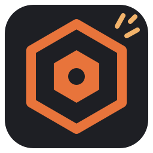
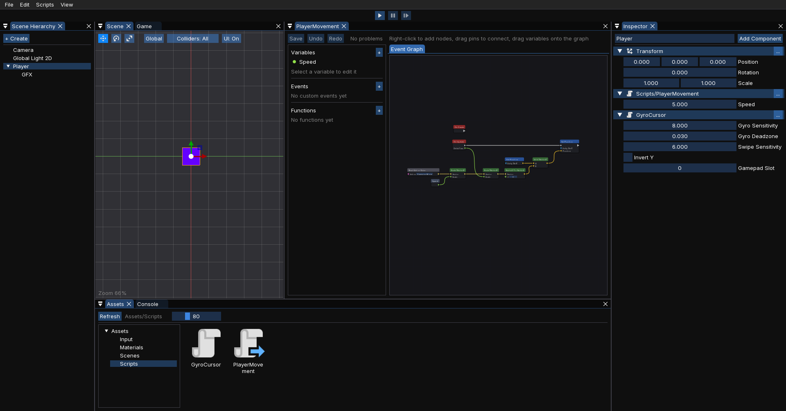

<p align="center">
  
</p>

<h1 align="center">ByteForge</h1>

<p align="center">
  A 2D game engine written in C++23 on Vulkan, with its own editor, C# and visual scripting, and a launcher.
</p>

<p align="center">
  <a href="https://github.com/Alcano22/ByteForge/actions/workflows/build.yml">
    
  </a>
  <a href="https://github.com/Alcano22/ByteForge/releases/latest">
    
  </a>
</p>

<!-- TODO: a GIF of the editor: building a small scene, pressing Play -->
<p align="center"></p>

## What it is

ByteForge is a lightweight, Unity-like engine for 2D games. It covers the whole path from an empty
project to a shipped game: you create a project in the **Hub**, build scenes in the **Editor**, script
them in **C#** or with **visual script graphs**, and export a standalone game for Windows or Linux.

It is a solo project and still before 1.0, so expect APIs to move.

## Features

**Rendering**
- Vulkan renderer behind a thin backend abstraction, HLSL shaders compiled with DXC
- Batched sprites with materials, sprite sheets and 2D lights
- MSDF text with rich-text tags, fonts prebuilt into atlases at build and export time

**Scene and gameplay**
- Entity-component scene on EnTT with parent-child hierarchy
- Prefabs with per-instance overrides that follow changes to the prefab
- 2D physics on Box2D with a fixed timestep
- Animation clips and animator controllers, audio on miniaudio
- Game UI: canvases, rect transforms, images, buttons and text

**Input**
- Keyboard, mouse and gamepads through SDL3
- DualSense support: adaptive triggers, light bar, touchpad, gyro and accelerometer
- Input Actions as assets, with composites, processors and delta controls for mouse and gyro aiming

**Scripting**
- C# on .NET 10, hosted by the engine
- Visual scripting with a node graph editor, sharing one API with C#
- Native C++ scripts

**Editor**
- Docking ImGui editor with scene, game, hierarchy, inspector, assets and console panels
- Undo and redo, play mode, sprite editor, animation and input action editors
- Export to a standalone game with all assets packed into one archive

**Hub**
- Qt 6 launcher to create and open projects
- Downloads editor versions from GitHub Releases; every project opens with its own version

## Getting started

Download the Hub for your platform from the [latest release](https://github.com/Alcano22/ByteForge/releases/latest),
start it, install an editor version and create a project.

<!-- TODO: link the docs once they exist -->

## Building from source

### Requirements

| | Linux | Windows |
|---|---|---|
| Compiler | Clang with C++23 support | MSVC (Visual Studio 2022) |
| CMake | 4.1 or newer, Ninja | 4.1 or newer, Ninja |
| Packages | [vcpkg](https://github.com/microsoft/vcpkg) with `VCPKG_ROOT` set | the same |
| .NET | .NET 10 SDK | .NET 10 SDK |
| Qt (Hub only) | Qt 6.5 or newer | Qt 6.5 or newer |

On Fedora, `install_requirements.sh` installs everything except vcpkg.

### Linux

```bash
git clone --recursive https://github.com/Alcano22/ByteForge.git
cd ByteForge
./install_requirements.sh

cmake --preset release
cmake --build --preset release
ctest --preset release -j "$(nproc)"
```

The build stages everything under `build-release/stage`; start the editor with
`build-release/stage/bin/Editor --project <path>` or open projects through the Hub.

### Windows

From a Developer PowerShell for Visual Studio:

```powershell
git clone --recursive https://github.com/Alcano22/ByteForge.git
cd ByteForge

cmake --preset windows-release -DCMAKE_PREFIX_PATH="C:/Qt/6.8.0/msvc2022_64"
cmake --build --preset windows-release
ctest --preset windows-release
```

### Options

| Option | Default | |
|---|---|---|
| `BYTEFORGE_BUILD_HUB` | `ON` | Build the Hub (needs Qt) |
| `BYTEFORGE_BUILD_TESTS` | `ON` | Build the unit tests |
| `BYTEFORGE_WARNINGS_AS_ERRORS` | `OFF` | Treat compiler warnings as errors |

### DualSense on Linux

The engine talks to PlayStation controllers through hidraw. Without access to it, the controller
still works as a plain gamepad, but without light bar, adaptive triggers, touchpad and gyro.
On Fedora, `sudo dnf install steam-devices` provides the udev rules.

## Repository layout

| Folder | |
|---|---|
| `Engine/` | The engine library: rendering, scene, physics, audio, input, assets, scripting runtime |
| `Editor/` | The ImGui editor and the game exporter |
| `Player/` | The runtime that exported games ship with |
| `ScriptCore/` | The C# side of the scripting API |
| `Hub/` | The Qt project launcher |
| `Tests/` | Catch2 unit tests |
| `Tools/` | Build-time tools, such as the font atlas baker |
| `Templates/` | Templates for new projects |

## Status

ByteForge is in active development. The next steps on the way to 1.0 are tilemaps, particles,
more physics shapes and joints, more UI controls, and stable script APIs.
<!-- TODO: link a roadmap or the GitHub milestones -->

## License

<!-- TODO: choose a license, see below -->

ByteForge ships the [Inter](https://rsms.me/inter/) font under the SIL Open Font License.
